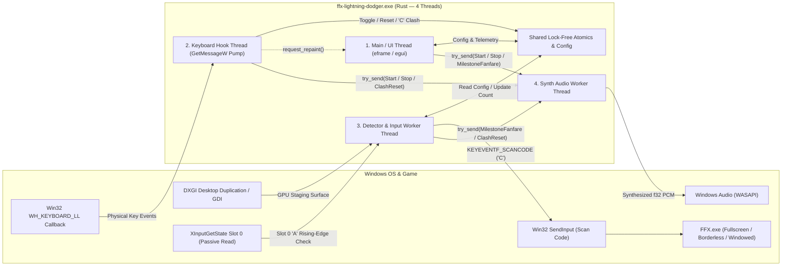
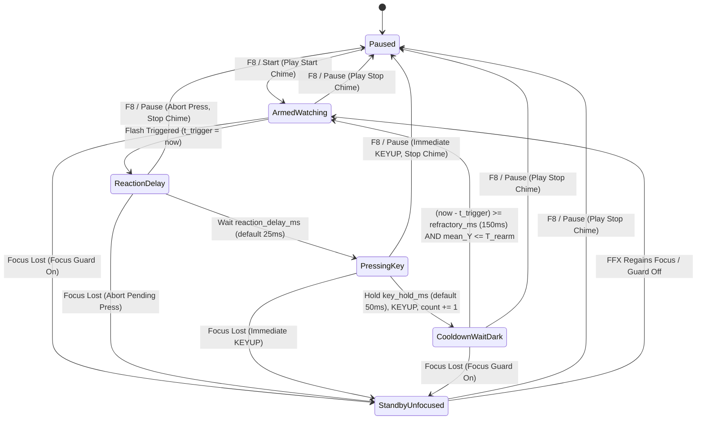

# FFX Lightning Dodger — Requirements & System Design Document

## 1. Overview & Context

### 1.1 Problem Statement
In *Final Fantasy X HD Remaster* (Windows PC), unlocking Lulu's Celestial Weapon upgrade (*Venus Sigil*) requires dodging **200 consecutive lightning bolts** in the Thunder Plains without getting struck, touching a Save Sphere, or leaving the area. On modern displays and PC frame pacing, sustaining frame-accurate reaction timing across 15–20 minutes of repetitive flashes is tedious and error-prone.

### 1.2 Solution Summary
**FFX Lightning Dodger** is a lightweight, standalone Windows desktop utility (`.exe`) that monitors the game screen in real time for the full-screen white flash that precedes every Thunder Plains lightning strike, waits a configurable millisecond reaction delay, and sends the PC *Confirm/Dodge* keyboard scan code (`C` by default) to execute the dodge.

### 1.3 Gameplay Operating Model
- **Human-Controlled Movement:** The player actively controls Tidus using their plugged-in controller (e.g., running the Thunder Plains crater trick or traversing the plains) with **No Encounters** enabled (via FFX PC's `F3` booster or equipment).
- **Automated Timed Button Press:** The application is strictly responsible for watching for lightning flashes and pressing the dodge button at the right moment.
- **Indefinite Execution:** Once started, the script runs indefinitely—continuing past 200 dodges—until the human player explicitly pauses/stops it via the UI or global hotkey.
- **Auditory Feedback:** Synthesized musical chimes notify the player on **Start**, **Stop/Pause**, **Clash Reset** (if a manual Confirm press resets an active streak), and **every $N$ dodges** (defaulting to `205` to provide a 5-dodge safety buffer over the 200-bolt requirement, configurable to any positive integer).

### 1.4 Non-Goals
- Reading or patching *Final Fantasy X* process memory (purely external screen-read + OS input simulation; not a memory trainer or DLL mod).
- Automating character movement, menu navigation, or combat.
- Requiring kernel-level virtual gamepad drivers (`ViGEmBus`) or external runtime installers (`.NET`, Python, AutoHotkey, or external `.wav` asset folders).

---

## 2. Requirements Specification

### 2.1 Functional Requirements

| ID | Requirement | Details |
| :--- | :--- | :--- |
| **FR-1** | **Full-Frame Flash Detection** | Continuously sample the active game display across a distributed spatial grid so detection remains invariant to camera panning and character movement. Trigger only on sudden, screen-wide luminance spikes characteristic of lightning flashes. |
| **FR-2** | **Driver-Free Dodge Input & Clash Handling** | Simulate a hardware scan-code keypress (`C` by default, user-rebindable including extended keys via `MAPVK_VK_TO_VSC_EX` + `KEYEVENTF_EXTENDEDKEY`) via Win32 `SendInput` after a configurable reaction delay (`25 ms` default) and hold it (`50 ms` default) so FFX's 30 FPS input loop registers it alongside an active physical controller. Passively monitor XInput **Slot 0** controller `A` and physical keyboard Confirm rising-edge presses while Armed and actively watching (`FFX.exe` focused or Focus Guard disabled), resetting the counter to `0` if a manual Confirm clash occurs (toggleable, default `On`). |
| **FR-3** | **Context-Aware Global Hotkeys** | Support system-wide hotkeys that work in Fullscreen, Borderless, and Windowed modes: **Start / Pause** (`F8` default) and **Reset Counter** (`F9` default)—chosen to avoid FFX boosters (`F1`–`F5`), Windows menu/context-menu keys (`F10` / `Shift+F10`), and Steam Screenshot (`F12`). Hotkeys are active and swallowed (`LRESULT(1)`) whenever `FFX.exe` or `ffx-lightning-dodger.exe` is focused, whenever `Armed` in any window (for emergency pause/reset), or whenever the Foreground Window Guard is disabled (for desktop dry-run testing); when `Paused` with Focus Guard enabled, keys pass through undisturbed to other applications. Both hotkeys are user-rebindable with duplicate-binding prevention across Start/Pause, Reset, and Dodge keys. |
| **FR-4** | **Stateful Dodge Counter** | Maintain an integer counter incremented once per triggered dodge. Toggling Start/Pause (`F8`) **pauses and resumes** without losing the current count; the count resets to `0` on explicit **Reset** (`F9` / UI button) or when the manual controller `A` / Confirm clash guard triggers while Armed and actively watching. |
| **FR-5** | **Every-$N$ Modulo Chime** | Provide a UI numeric input accepting any positive integer $N \ge 1$ (default `205`). Whenever `count > 0 && count % N == 0`, play the synthesized completion fanfare **without** stopping or pausing the auto-dodger. |
| **FR-6** | **Built-in Synthesized Chimes** | Synthesize distinct, click-free musical audio cues in memory: **Start** (rising 2-note arpeggio), **Stop/Pause** (falling 2-note tone), **Every-$N$ Milestone** (the classic 9-note *Final Fantasy* Victory Fanfare intro), and a subtle **Clash Reset** double-blip if manual `A` / Confirm resets a non-zero streak. Overlapping cues cleanly preempt any playing cue via a `10 ms` click-free fade-out. Dodges not landing on a multiple of $N$ remain silent. |
| **FR-7** | **Foreground Window Guard** | By default, only detect flashes, monitor clashes, and send dodge inputs when *Final Fantasy X* is the foreground window—matched via case-insensitive executable basename `FFX.exe` (`QueryFullProcessImageNameW` with `PROCESS_QUERY_LIMITED_INFORMATION`), falling back to exact window title `"FINAL FANTASY X"` if process query is unavailable. Include an Advanced toggle to disable this guard for desktop testing, which always resets to `On` (`true`) on application launch for safety. |
| **FR-8** | **Compact Dark Utility UI** | Present a `330x270 px` (`330x450 px` expanded) dark-themed native window with Start/Pause button, status indicator, large dodge counter, Reset button, "Chime Every $N$ Dodges" control + preview button, volume slider, "Always on Top" toggle, hotkey rebinders, and a collapsible Advanced Timing & Calibration section. |

### 2.2 Non-Functional Requirements
- **Packaging:** Single portable Windows x64 executable (`ffx-lightning-dodger.exe`), target binary size `< 8 MB`, zero external asset files.
- **Latency:** Capture-to-decision processing `< 2 ms` per frame; total loop wake/polling interval $\le 8\text{ ms}$ ($\ge 120\text{ Hz}$ inspection rate or `AcquireNextFrame(8, ...)` VSync-locked DXGI frame arrival) to catch frame-1 of any 60 Hz / 30 FPS flash across `1x`, `2x`, and `4x` game speeds.
- **Resource Footprint:** `< 2%` CPU utilization and `< 40 MB` RAM during active monitoring.
- **Portability & Config:** Persist user preferences (`chime_every_n`, `volume`, `start_pause_key`, `reset_key`, `dodge_key`, `reaction_delay_ms`, `key_hold_ms`, `refractory_ms`, `flash_threshold`, `clash_reset`, and `always_on_top`) in `%APPDATA%\ffx-lightning-dodger\config.json`, silently falling back to defaults if absent so the `.exe` can be moved freely. `require_ffx_focus` is intentionally transient and always initializes to `true` on launch.
- **Build Compatibility:** Rust crate choices must compile cleanly on both native Windows (`x86_64-pc-windows-msvc`) and Linux-to-Windows cross-compilation (`x86_64-pc-windows-gnu`).

---

## 3. System Architecture & Threading Model

> [!IMPORTANT]
> **Real-Time & OS Hook Isolation Principle:** Neither GUI rendering, Win32 title-bar modal drag/resize loops, nor audio playback may ever block the detection/input loop or OS keyboard delivery. In the Thunder Plains "crater trick," landing from a jump triggers a second lightning bolt within ~`1.0 s` at `1x` (~`225 ms` at `4x`)—meaning the ~`2.83 s` *Final Fantasy* Victory Fanfare at dodge 205 will overlap with dodge 206 if the player keeps running. The application therefore separates GUI rendering, `WH_KEYBOARD_LL` message pumping, screen detection/input, and audio synthesis onto **four dedicated threads**.



### Thread Responsibilities
1. **Main / UI Thread (`eframe`):** Enforces `PerMonitorV2` DPI awareness at startup, renders the compact `330x270` dark window (reactive repaint + ~15–30 Hz telemetry refresh while visible), updates configuration atomically, and dispatches UI-initiated `Start`, `Stop`, and `[🔊]` `MilestoneFanfare` preview events.
2. **Keyboard Hook Thread (`WH_KEYBOARD_LL` + Win32 Message Pump):** Installs `SetWindowsHookExW(WH_KEYBOARD_LL, ...)` on a dedicated lightweight Win32 `GetMessageW` loop—isolated from `eframe`/`winit` so Win32 modal window-drag/resize loops on the UI thread can never stall OS keyboard input or trip Windows' `LowLevelHooksTimeout`. Performs context-aware `F8`/`F9` dispatch + `LRESULT(1)` key swallowing and non-injected (`!LLMHF_INJECTED`) physical Confirm clash checks, updating `STATE` atomically, waking the UI (`egui::Context::request_repaint`), and enqueuing `AudioEvent`s via non-blocking `try_send`.
3. **Detector & Input Worker Thread (High-Priority Background Thread):** Runs a tight `AcquireNextFrame(8, ...)` capture, rising-edge `XInputGetState(0, ...)` clash check, and interruptible dodge state-machine loop using `timeBeginPeriod(1)` (1 ms Windows timer resolution) while Armed so `25 ms` reaction and `50 ms` key-hold waits achieve $\pm 1\text{ ms}$ precision rather than Windows' default $15.6\text{ ms}$ scheduler quantum.
4. **Audio Worker Thread:** Listens on a bounded `std::sync::mpsc::sync_channel<AudioEvent>(16)` (`Start`, `Stop`, `ClashReset`, `MilestoneFanfare`) and streams generated `44,100 Hz` `f32` PCM to the default WASAPI output device, cleanly preempting any active cue with a `10 ms` raised-cosine fade-out when a new event arrives.

---

## 4. Detailed Subsystem Design

### 4.1 Screen Capture & Movement-Safe Flash Detection

#### Why Single-Pixel Checks Fail Here
Traditional scripts require wedging Tidus completely motionless into a corner and checking a single `(x, y)` coordinate. Because the human player will be actively steering Tidus around the Thunder Plains, local pixel colors constantly shift as rocks, puddles, lightning towers, and Cactuar stones pan across the camera.

#### Visual Signature of an FFX Thunder Plains Strike
- Ambient thunder *audio* occurs randomly in the soundtrack without a strike, **but the full-screen white flash only occurs when an actual lightning bolt is targeting Tidus**.
- During a strike flash, the game overlays a near-white / pale-blue-white full-frame additive flash across the entire 16:9 viewport for several frames before the bolt lands (~1,000 ms window at 1x speed).

#### Capture Strategy, DPI Awareness, & Pixel Formats
1. **Per-Monitor V2 DPI Awareness:** At the very start of `main()` (before window creation) call `SetProcessDpiAwarenessContext(DPI_AWARENESS_CONTEXT_PER_MONITOR_AWARE_V2)` in addition to embedding `PerMonitorV2` in the application manifest. This guarantees Win32 `GetClientRect` / `ClientToScreen` return unscaled physical pixel coordinates matching DXGI output surfaces on 125% / 150% / 200% DPI-scaled monitors.
2. **Primary API — DXGI Desktop Duplication (`IDXGIOutputDuplication`):** Captures composed desktop frames directly from GPU staging memory in `< 0.5 ms` (`AcquireNextFrame(8, ...)` so static desktop frames wake every `8 ms` without busy-spinning) for the monitor hosting the `FFX.exe` window. Works seamlessly in **Borderless** and **Windowed** modes, and in Windows 10/11 Fullscreen Optimizations (FSO).
3. **Multi-Format & HDR Decoding:** At the 48 sample coordinates, decode `DXGI_FORMAT_B8G8R8A8_UNORM`, `DXGI_FORMAT_R8G8B8A8_UNORM`, `DXGI_FORMAT_R10G10B10A2_UNORM` (10-bit SDR/WCG), and `DXGI_FORMAT_R16G16B16A16_FLOAT` (Windows 10/11 HDR / Auto-HDR linear scRGB converted relative to SDR white into clamped `[0.0, 1.0]` gamma-encoded sRGB).
4. **Fallback API — GDI `BitBlt` (`SRCCOPY`) on Target Monitor/Window Client Rect:** Automatically engaged if DXGI returns `DXGI_ERROR_ACCESS_LOST` (e.g., mode switch or GPU driver reset) while DXGI re-initializes, or if a driver exposes an exotic surface format outside the four formats above.

> [!NOTE]
> *Final Fantasy X HD Remaster* supports `Windowed`, `Borderless`, and `Full Screen` in its launcher. While Windows 10/11 Fullscreen Optimizations allow DXGI capture in `Full Screen`, `Borderless` should be documented in a subtle UI tooltip as recommended if a GPU driver blocks exclusive fullscreen capture.

#### Spatial Grid Sampling & Dual-Threshold Algorithm
To make CPU cost negligible (`< 0.1 ms` per frame) while remaining immune to local camera movement:
1. **Safe Inner Viewport Crop & Bounds Clipping:** Determine the physical pixel bounds of the `FFX.exe` client area (or primary monitor if "Only active when FINAL FANTASY X is focused" is disabled). Inset by **15% on all four sides** (evaluating the central `70% x 70%` box) and intersect with the target monitor's physical desktop rectangle (skipping sampling cleanly if the window is minimized or the clipped box is `< 16 x 16 px`). This automatically ignores window borders, 16:10 / 21:9 black pillarbox/letterbox bars, Steam achievement popups in corners, and minimap/HUD overlays.
2. **48-Point Strided Grid (`8 x 6`):** Read only 48 evenly spaced pixels directly from the mapped staging surface (no full-image copy or resize needed).
3. **Per-Point sRGB Luma:** Convert each sampled pixel `(R, G, B)` in gamma-encoded sRGB `[0.0, 1.0]` using Rec. 709 weights:
   $$Y_i = 0.2126 R_i + 0.7152 G_i + 0.0722 B_i$$
4. **Frame Metrics & Slider Coupling:**
   - `T_high`: User-configurable `Flash Threshold` (default `0.80`, i.e., sRGB $\approx 204/255$), clamped in UI and config loading to **`[0.60, 0.95]`** (`60%–95%`).
   - `T_rearm`: Derived dark re-arm threshold $\min(0.45,\; T_{\text{high}} - 0.20)$ (`0.45` at default `80%`), with baseline update ceiling $T_{\text{base\_max}} = \min(0.55,\; T_{\text{high}} - 0.15)$, guaranteeing `T_rearm < T_high` so `CooldownWaitDark` can never deadlock at lower slider settings.
   - `bright_fraction`: Fraction of the 48 grid points where $Y_i \ge T_{\text{high}}$ **and** minimal color saturation ($\max(R,G,B) - \min(R,G,B) \le 0.25$, ensuring saturated spell/UI colors don't masquerade as white lightning).
   - `mean_Y`: Average luma across all 48 grid points: $\bar{Y} = \frac{1}{48}\sum Y_i$.
   - `baseline_Y`: Exponential moving average ($\alpha = 0.05$) updated *only* when `mean_Y < T_base_max` (normal dark grey/blue Thunder Plains ambiance typically sits around $\bar{Y} \in [0.12, 0.32]$).
5. **Trigger Condition (Rising Edge):**
   - `bright_fraction >= 0.75` (at least 36 of 48 points across the screen are simultaneously bright white) **AND**
   - `(mean_Y - baseline_Y) >= 0.35` (sharp sudden spike relative to recent ambient scene brightness).

#### Hysteresis, Interruptible Waits, & Cooldown State Machine
To prevent double-triggering on a single lingering flash while catching rapid back-to-back crater strikes across **1x, 2x, and 4x PC Turbo Speeds** (where Tidus's ~`900 ms` dodge jump finishes in ~`900 ms` at `1x`, ~`450 ms` at `2x`, and ~`225 ms` at `4x`):



- **Interruptible Millisecond Waits:** Neither `ReactionDelay` (`25 ms`) nor `PressingKey` (`50 ms`) uses a blind monolithic `thread::sleep`. Instead, the worker waits in `1–2 ms` slices while checking `state.armed` and Foreground Window Guard status—aborting a pending press before `SendInput` if the player Alt-Tabs or pauses during `ReactionDelay`, and immediately emitting `KEYEVENTF_KEYUP` if interrupted during `PressingKey`.
- **Why `CooldownWaitDark` checks BOTH `refractory_ms = 150 ms` (from `t_trigger`) and darkness (`mean_Y <= T_rearm`):**
  - At **1x speed**, the lightning flash stays bright for ~`180–220 ms`; even after `150 ms` has elapsed from `t_trigger`, `mean_Y <= T_rearm` (`0.45`) holds the detector in `CooldownWaitDark` until the dark Thunder Plains palette returns, guaranteeing at most 1 press per flash.
  - At **2x and 4x PC Booster speeds**, the flash fades in ~`50–100 ms` and Tidus lands back in the North Crater after ~`450 ms` (`2x`) or ~`225 ms` (`4x`). Measuring the `150 ms` refractory from `t_trigger` (`25 ms` delay + `50 ms` hold + `75 ms` post-release margin = `150 ms` total) ensures the detector re-arms cleanly **before** the `225 ms` 4x jump completes.

---

### 4.2 Input Simulation & Physical Controller Clash Handling

#### Avoiding the XInput Slot 0 Conflict
In *Final Fantasy X HD Remaster* on PC:
1. When a physical controller is plugged in, Windows binds it to **XInput Slot 0 (Player 1)**, and FFX ignores inputs from XInput Slots 1–3. A virtual Xbox controller (via `ViGEmBus`) would attach to Slot 1 and do nothing unless the user unplugged their controller or used HID-hiding drivers.
2. However, FFX PC natively listens to **DirectInput / raw keyboard scan codes simultaneously** alongside Player 1's gamepad. Pressing keyboard `C` (FFX's default *Confirm* binding) triggers the lightning dodge immediately while the user continues holding the analog stick on their physical controller.

#### Accounting for Physical Controller `"A"` / Manual Confirm Clashes
While the operating assumption is that the human player **only steers movement** and never presses `"A"` on the controller while Armed, accidental or premature `"A"` / Confirm presses create three in-game clash hazards:
1. **FFX Anti-Turbo Lockout (~0.5 s Penalty Window):** Pressing Confirm (`A` or `C`) within ~10–15 frames *before* a lightning flash begins locks out the dodge window for that bolt—causing Tidus to get struck even if the app subsequently presses `C` on the flash, resetting the **in-game** consecutive streak to `0`.
2. **Save Sphere / Object Interactions:** Pressing `A` near a Thunder Plains Save Sphere opens the save prompt, which immediately resets FFX's **in-game** consecutive dodge streak to `0`.
3. **Simultaneous Input Masking:** Holding controller `A` down while the app injects keyboard `C` can mask the fresh Confirm rising edge FFX expects during the dodge window.

**Designed Clash Mitigation (Passive `XInputGetState` Slot 0 & Hook Guard — Default `ON`):**
- While **Armed and actively watching** (i.e., `FFX.exe` is focused, OR `require_ffx_focus` is unchecked for desktop dry-run; suppressed in `StandbyUnfocused`):
  - Passively poll **only XInput Slot 0** via Win32 `XInputGetState(0, &mut state)` (`Windows::Win32::UI::Input::XboxController`, read-only, zero drivers required) for a **rising-edge** `XINPUT_GAMEPAD_A` button-down transition (`!prev_a && curr_a`). When Slot 0 returns `ERROR_DEVICE_NOT_CONNECTED`, back off Slot 0 polling to once every `500 ms` so PCs without an Xbox controller incur zero Win32 device-enumeration overhead (preserving `< 2 ms` loop latency) and secondary controllers on Slots 1–3 cannot cause false resets.
  - Observe non-injected (`!LLMHF_INJECTED`) physical key-down rising edges (`!was_down`) of the configured Confirm key (`C`) in `WH_KEYBOARD_LL`.
- If a manual controller `"A"` or physical Confirm rising-edge press is detected while Armed and actively watching:
  - **Reset `dodge_count` to `0`** (so the app never over-reports a potentially broken or locked-out in-game streak),
  - Display a brief amber status notice (`"Manual 'A' / Confirm pressed — Counter Reset"`), and
  - Play the short `ClashReset` warning double-blip if `previous_count > 0`.
- Expose `[x] Reset counter on manual 'A' / Confirm press` in *Advanced Settings* (default `On`), and note in tooltip documentation that non-XInput DirectInput-only gamepads (without Steam Input / XInput translation) are not visible to `XInputGetState`, so players should Pause (`F8`) before interacting with menus, chests, or Save Spheres.

#### Exact Win32 `SendInput` & Foreground Matching Implementation
- **Extended-Aware Scan Codes:** Map the configured key (default `'C'`) dynamically via `MapVirtualKeyW(vk, MAPVK_VK_TO_VSC_EX)`. Extract the low byte as `wScan`, and if the high byte is `0xE0` or `0xE1` (e.g., user rebound Confirm to Arrow keys, `Right Ctrl`, `Insert`/`Home`, or `Numpad Enter`), include `KEYEVENTF_EXTENDEDKEY` alongside `KEYEVENTF_SCANCODE` (do **not** rely solely on virtual-key codes without scan codes, as DirectInput games ignore synthetic `wVk`-only events).
- **Sequence:**
  1. Interruptibly wait `reaction_delay_ms` (default `25 ms`). `25 ms` safely lands inside frame 1–2 of the flash without tripping pre-flash lockout.
  2. Send `KEYEVENTF_SCANCODE` (`| KEYEVENTF_EXTENDEDKEY` if extended) Key Down.
  3. Interruptibly wait `key_hold_ms` (default `50 ms`). **Must default to $\ge 45\text{ ms}$**: FFX polls input once per 30 FPS logic tick ($33.33\text{ ms}$); holds shorter than $34\text{ ms}$ risk falling entirely between two game ticks!
  4. Send `KEYEVENTF_SCANCODE | KEYEVENTF_KEYUP` (`| KEYEVENTF_EXTENDEDKEY` if extended) Key Up.
- **Safety Cleanup:** If the user pauses (`F8`), loses FFX focus (when Focus Guard is `On`), or closes the app while inside `PressingKey`, immediately emit the matching `KEYEVENTF_KEYUP` so the dodge key is never left stuck down.
- **Foreground Process Matching:** Identify the foreground window (`GetForegroundWindow` $\rightarrow$ `GetWindowThreadProcessId` $\rightarrow$ `OpenProcess(PROCESS_QUERY_LIMITED_INFORMATION)` $\rightarrow$ `QueryFullProcessImageNameW`) by case-insensitive executable basename `ffx.exe` so Japanese/Chinese/Korean/European builds with localized window titles work out of the box, falling back to exact window title `"FINAL FANTASY X"` only if process image query fails.

> [!WARNING]
> **Windows UIPI (Admin Elevation) Edge Case:** If a user launches Steam or `FFX.exe` as Administrator, Windows User Interface Privilege Isolation (UIPI) silently blocks `SendInput` and hotkeys from non-elevated apps. Embed a standard `asInvoker` + `PerMonitorV2` manifest so no UAC prompt nags normal users, **and** check whether the foreground `FFX.exe` process token is elevated (`OpenProcess(PROCESS_QUERY_LIMITED_INFORMATION)` $\rightarrow$ `OpenProcessToken(TOKEN_QUERY)` $\rightarrow$ `GetTokenInformation(TokenElevation)`, which succeeds across UIPI boundaries); if `FFX.exe` is elevated and this app is not, display a clear yellow banner in the UI: *"FFX is running as Administrator — restart this app as Admin so keypresses can reach the game."*

---

### 4.3 Counter & Every-$N$ Chime Mechanism

#### State & Controls
- `dodge_count: u32` (initialized to `0` on app launch).
- `chime_every_n: NonZeroU32` (default `205`; UI enforces integer $\ge 1$, clamping `0` or invalid text back to `1` or previous valid value).
- **On Start / Pause Toggle (`F8` or UI Primary Button):**
  - `Paused -> Armed`: `dodge_count` is **preserved** (allows pausing mid-streak to take a break or open the FFX pause menu). Enqueues `AudioEvent::Start`.
  - `Armed -> Paused`: `dodge_count` is **preserved**. Enqueues `AudioEvent::Stop`.
- **On Explicit Reset (`F9` or UI Reset Button):**
  - Sets `dodge_count = 0` immediately (works whether Armed or Paused).
- **On Manual `"A"` / Confirm Clash (While Armed & Actively Watching, if Clash Guard enabled):**
  - Sets `dodge_count = 0`; if previous count was `> 0`, enqueues `AudioEvent::ClashReset`.
- **On Successful Dodge Trigger (Immediately after normal Key Up):**
  ```rust
  let new_count = state.dodge_count.fetch_add(1, Ordering::Relaxed) + 1;
  let interval = state.chime_every_n.load(Ordering::Relaxed); // >= 1
  if new_count % interval == 0 {
      let _ = audio_tx.try_send(AudioEvent::MilestoneFanfare);
  }
  ```
  - **Examples:**
    - `chime_every_n = 205` (default): Fanfare plays at `205, 410, 615, ...` while auto-dodging continues uninterrupted.
    - `chime_every_n = 21`: Fanfare plays at `21, 42, 63, ..., 189, 210, ...`.
    - `chime_every_n = 1`: Plays on every dodge (useful if a player wants auditory confirmation during initial testing; overlapping triggers cleanly preempt via a `10 ms` fade-out).

---

### 4.4 Synthesized Audio Chimes Specification

All chimes are generated procedurally at `44,100 Hz` mono `f32` PCM—zero external `.wav`/`.mp3` files—pitched cohesively in **$\text{E}\flat$ Major** (the authentic key of the *Final Fantasy* Victory Fanfare), using the unified `AudioEvent` enum (`Start`, `Stop`, `ClashReset`, `MilestoneFanfare`).

#### Timbre, Normalization, & Click-Free Preemption
To sound crisp and triumphant over the Thunder Plains storm ambiance without harsh buzzer aliasing, clipping, or speaker clicks:
- **Lead & Harmony Voices:** Band-limited bright synth-brass / chiptune blend (`0.55 * sin(2π f t) + 0.30 * triangle(2π f t) + 0.15 * sin(2π (2f) t)`), with subtle `5.5 Hz` vibrato ($\pm 0.4\%$ pitch) engaging after `150 ms` on sustained notes.
- **Bass Voice (Fanfare Chords):** Warm triangle + fundamental sine (`0.70 * triangle(2π f t) + 0.30 * sin(2π f t)`).
- **Voice Mixing Weights (Fanfare):** `0.50 * Lead + 0.15 * Harmony_1 + 0.15 * Harmony_2 + 0.20 * Bass` (`0.30` total across the two harmony notes), guaranteeing unclipped polyphonic peak amplitude strictly within `[-1.0, 1.0]`.
- **Per-Note ADSR Envelope:** `6 ms` linear attack, gentle sustain/decay (`0.80` sustain floor for brass body), and `10 ms` raised-cosine release fade-out to zero (eliminating zero-crossing clicks).
- **Overlapping Cue Preemption:** Whenever a new `AudioEvent` arrives on `sync_channel` while a previous cue is still playing (e.g., `chime_every_n = 1` on rapid bolts, or pressing `F8` Pause / `ClashReset` mid-`2.83 s` fanfare), the audio worker applies a `10 ms` raised-cosine fade-out (`441` samples) to the active buffer before starting the new cue—preventing WASAPI clipping (`> 1.0`) and out-of-phase fanfare collisions.
- **Default Master Volume:** `65%` (`0.35` peak headroom), adjustable via a persisted UI volume slider (`0%–100%`) plus a **Test (`🔊`)** button next to the *Chime Every $N$* input that enqueues `AudioEvent::MilestoneFanfare` so the user can preview the fanfare immediately.

#### Cue Summary

| Cue (`AudioEvent`) | Trigger | Notes & Frequencies ($\text{E}\flat$ Major) | Timing | Character |
| :--- | :--- | :--- | :--- | :--- |
| **`Start`** | Entering `Armed` state | `Bb4` (`466.16 Hz`) $\rightarrow$ `Eb5` (`622.25 Hz`) | `75 ms` + `15 ms` gap + `120 ms` (~`210 ms` total) | Crisp rising fourth into tonic ("armed / ready") |
| **`Stop`** | Entering `Paused` state | `Eb5` (`622.25 Hz`) $\rightarrow$ `Bb4` (`466.16 Hz`) | `75 ms` + `15 ms` gap + `130 ms` (~`220 ms` total) | Gentle falling fourth ("paused / standby") |
| **`ClashReset`** | Manual Slot 0 `A` / physical Confirm while Armed & watching (`count > 0`) | `Eb4` (`311.13 Hz`) $\rightarrow$ `D4` (`293.66 Hz`) | `55 ms` + `20 ms` gap + `75 ms` (~`150 ms` total) | Subtle low minor-second alert ("streak reset") |
| **`MilestoneFanfare`** | `count > 0 && count % N == 0` or `[🔊]` preview button | Classic 9-note *Final Fantasy* Victory Fanfare intro (*"Da-da-da-DAAA, daa, daa, da-da-DAAA!"*) with $\text{I} - \flat\text{VI} - \flat\text{VII} - \text{I}$ polyphonic triad backing | `138 BPM` ($1\text{ beat} = 435\text{ ms}$, triplet eighth $= 145\text{ ms}$, ~`2.83 s` total) | Unmistakable classic *Final Fantasy* battle victory fanfare |

#### Exact Sequencer Table — Classic *Final Fantasy* Victory Fanfare (`138 BPM`, $\text{E}\flat$ Major)

| Step | Beat Subdivision | Lead Melody (`Hz`) | Harmony Voices (`0.15` each, `Hz`) | Bass Voice (`Hz`) | Gate (Sound) | Gap / Rest | Step Total |
| :---: | :--- | :--- | :--- | :--- | :---: | :---: | :---: |
| **1** | Beat 1 — Triplet 1 | `Eb5` (`622.25`) | `Bb4` (`466.16`), `G4` (`392.00`) | — | `110 ms` | `35 ms` | `145 ms` |
| **2** | Beat 1 — Triplet 2 | `Eb5` (`622.25`) | `Bb4` (`466.16`), `G4` (`392.00`) | — | `110 ms` | `35 ms` | `145 ms` |
| **3** | Beat 1 — Triplet 3 | `Eb5` (`622.25`) | `Bb4` (`466.16`), `G4` (`392.00`) | — | `110 ms` | `35 ms` | `145 ms` |
| **4** | Beat 2 — Quarter ($\text{E}\flat$) | `Eb5` (`622.25`) | `Bb4` (`466.16`), `G4` (`392.00`) | `Eb3` (`155.56`) | `395 ms` | `40 ms` | `435 ms` |
| **5** | Beat 3 — Quarter ($\flat\text{VI} = \text{C}\flat/\text{B}$) | `B4` (`493.88`) | `Gb4` (`369.99`), `Eb4` (`311.13`) | `B2` (`123.47`) | `395 ms` | `40 ms` | `435 ms` |
| **6** | Beat 4 — Quarter ($\flat\text{VII} = \text{D}\flat$) | `Db5` (`554.37`) | `Ab4` (`415.30`), `F4` (`349.23`) | `Db3` (`138.59`) | `395 ms` | `40 ms` | `435 ms` |
| **7** | Beat 5 — Triplets 1–2 ($\text{E}\flat$) | `Eb5` (`622.25`) | `Bb4` (`466.16`), `G4` (`392.00`) | `Eb3` (`155.56`) | `165 ms` | `125 ms` *(breath)* | `290 ms` |
| **8** | Beat 5 — Triplet 3 pickup ($\text{D}\flat$) | `Db5` (`554.37`) | `Ab4` (`415.30`), `F4` (`349.23`) | — | `115 ms` | `30 ms` | `145 ms` |
| **9** | Beat 6+ — Sustained Tonic ($\text{E}\flat$) | `Eb5` (`622.25`) | `Bb4` (`466.16`), `G4` (`392.00`) | `Eb3` (`155.56`) | `650 ms` | `0 ms` | `650 ms` |

---

### 4.5 User Interface & Global Hotkey Design

#### Window Properties
- **Dimensions:** `330 x 270 px` default (expands vertically to `330 x 450 px` when *Hotkeys & Advanced Settings* is unfolded). Non-intrusive on a second monitor or corner of the desktop.
- **Theme:** Deep slate dark theme (`#14171F` background, `#3B82F6` electric-blue accent when Armed, `#10B981` emerald pulse on dodge, `#F59E0B` amber when Armed-but-FFX-Unfocused).
- **Subsystem:** `#![windows_subsystem = "windows"]` so launching the `.exe` opens **only** the GUI window with no background `cmd.exe` console.

#### Wireframe Layout
```text
+--------------------------------------------------+
| ⚡ FFX Lightning Dodger           [📌 Top: OFF]  |
+--------------------------------------------------+
|  Status: ● ARMED — Watching FFX                  |
|                                                  |
|        +--------------------------------+        |
|        |           142                  |        |
|        |      DODGES  [  Reset (F9)  ]  |        |
|        +--------------------------------+        |
|                                                  |
|  [       ⏸ PAUSE AUTO-DODGE (F8)        ]        |
|                                                  |
|  Chime Every: [  205  ] [-][+] dodges    [🔊]    |
|  Volume:      [========o----] 65%                |
|                                                  |
|  ▸ Hotkeys & Advanced Settings                   |
+--------------------------------------------------+
|  (When Expanded:)                                |
|  Start/Pause Key: [  F8  ]  Reset Key: [  F9  ]  |
|  FFX Dodge Key:   [  C  ]   (Confirm scan code)  |
|  Reaction Delay:  [===o---------]  25 ms         |
|  Key Hold Time:   [=====o-------]  50 ms         |
|  Refractory Wait: [===o---------] 150 ms         |
|  Flash Threshold: [======o------] 80% (60–95%)   |
|  Live Brightness: [███░░░░░░░░░░] 0.21 (Dark)    |
|  [x] Only active when FINAL FANTASY X is focused |
|  [x] Reset counter on manual 'A' / Confirm press |
+--------------------------------------------------+
```

#### Shortcut Interference Audit (Why `F8` & `F9` Instead of `F10` / `Shift+F10`)

| Key / Shortcut | FFX HD Remaster (PC) | Windows OS / Steam / Overlays | Suitability |
| :--- | :--- | :--- | :--- |
| **`F1` – `F5`** | Built-in PC Boosters (`F1` Speed, `F2` Supercharge, `F3` Encounters, `F4` Auto-Battle, `F5` Hide HUD) | — | **Conflict** (triggers game cheats/HUD) |
| **`F6`, `F7`** | Unbound | `F6` cycles pane focus in some Win32 apps | Safe secondary options |
| **`F8`, `F9`** | **Unbound** | **Unbound** (`Alt+F9` is NVIDIA record, bare `F8`/`F9` are completely free) | **Recommended Defaults (`F8` Start/Pause, `F9` Reset)** |
| **`F10`** | Unbound | **Win32 `WM_SYSKEYDOWN` (`SC_KEYMENU`)** — activates window menu bar; in Windowed/Borderless Win32 games, `DefWindowProc` can enter a modal menu freeze or play system beep! | Avoid as default (supported safely if user rebinds via hook suppression below) |
| **`Shift+F10`** | Unbound | **Windows Context Menu (`WM_CONTEXTMENU`)** — equivalent to Right-Click across Windows | Avoid as default |
| **`F11` / `F12`** | Unbound | `F11` toggles Fullscreen in apps; **`F12` is Steam Screenshot** | **Conflict** (`F12` spams screenshots) |

#### Global Hotkey Implementation Detail
- Use a dedicated low-level keyboard hook (`SetWindowsHookExW(WH_KEYBOARD_LL, ...)` on Thread 2's lightweight Win32 `GetMessageW` thread).
- **Why `WH_KEYBOARD_LL` is preferred:** DirectX / fullscreen games occasionally ignore `RegisterHotKey`, whereas `WH_KEYBOARD_LL` reliably observes physical key-down events (`WM_KEYDOWN` / `WM_SYSKEYDOWN`) across Fullscreen and Borderless games without stealing focus, and distinguishes physical presses from synthetic `SendInput` events via `LLMHF_INJECTED`.
- **Context-Aware Dispatch & Swallowing (`LRESULT(1)`):** Hotkeys are active and swallowed (`LRESULT(1)`, suppressing pass-through to `DefWindowProc` so even a rebound `F10` cannot trigger `SC_KEYMENU`) whenever **any** of the following holds:
  1. `FFX.exe` or `ffx-lightning-dodger.exe` is the foreground window,
  2. `state.armed` is `true` (so the user can always emergency-pause or reset from any focused window), **or**
  3. `state.require_ffx_focus` is `false` (enabling full Desktop Dry-Run testing in Notepad or other windows).
  When `Paused` with `require_ffx_focus == true` and another application (e.g., browser or IDE) is focused, `WH_KEYBOARD_LL` passes keys straight through via `CallNextHookEx` so background idle instances never hijack `F8`/`F9` in other software.
- **Debouncing & Rebind Validation:** Trigger hotkeys on physical key-down rising edge only (ignoring OS key-repeat while held), suppress hotkeys while a UI *"Press any key..."* rebind control is actively capturing (`Esc` cancels rebinding), and reject duplicate bindings across `Start/Pause`, `Reset`, and `FFX Dodge Key`.

---

## 5. Recommended Tech Stack & Build Configuration

### 5.1 Rust Crate Selection

| Concern | Recommended Crate(s) | Rationale |
| :--- | :--- | :--- |
| **GUI** | `eframe` + `egui` (with `glow` backend, `default-features = false`, enabling `glow` + `winit`) | Pure Rust + OpenGL (`opengl32.dll` built into every Windows PC). Keeps stripped `.exe` around `~4–6 MB` (much smaller than `wgpu` shader compilers or WebView/Tauri). |
| **Windows APIs (Capture, DPI, Input, XInput, Hooks, Focus)** | `windows` (official Microsoft crate) | Direct zero-overhead access to `Graphics::Dxgi` (`IDXGIOutputDuplication`), `Graphics::Gdi` (`BitBlt`), `UI::HiDpi` (`SetProcessDpiAwarenessContext`), `UI::Input::KeyboardAndMouse` (`SendInput`, `MapVirtualKeyW`), `UI::Input::XboxController` (`XInputGetState`), `UI::WindowsAndMessaging` (`GetForegroundWindow`, `SetWindowsHookExW`), `System::Threading` (`OpenProcess`, `QueryFullProcessImageNameW`), and `Media` (`timeBeginPeriod`). |
| **Audio Playback** | `cpal` or `rodio` (`default-features = false`, WASAPI only) | Since PCM is synthesized in code, FLAC/MP3/Vorbis decoders are unneeded; streams `44,100 Hz` `f32` samples via WASAPI with tiny binary footprint. |
| **Config Serialization** | `serde` + `serde_json` + `dirs` | Lightweight persistence to `%APPDATA%\ffx-lightning-dodger\config.json`. |

### 5.2 Proposed Project Structure
```text
ffx-lightning-dodger/
├── Cargo.toml
├── app.manifest             # asInvoker execution level + PerMonitorV2 DPI awareness
├── build.rs                 # Embeds app.manifest & icon (graceful check for mingw windres)
└── src/
    ├── main.rs              # #![windows_subsystem = "windows"], DPI init, 4-thread wiring, eframe launch
    ├── config.rs            # Persisted UserConfig (N=205, vol=0.65, F8/F9/'C', 25/50/150ms, thresh=0.80, clash=true, top=false)
    ├── state.rs             # Lock-free atomics + transient require_ffx_focus=true + shared telemetry
    ├── capture.rs           # DXGI Duplication (BGRA8/RGBA8/R10G10B10A2/RGBA16F) + GDI fallback + clipped 8x6 sampler
    ├── detector.rs          # sRGB luma math, coupled T_rearm/EMA baseline, interruptible hysteresis state machine
    ├── input.rs             # Extended-aware SendInput, Slot 0 rising-edge XInput clash check, FFX.exe & UIPI checks
    ├── hotkeys.rs           # Dedicated WH_KEYBOARD_LL message-pump thread, context-aware swallowing, physical 'C' check
    ├── audio.rs             # Procedural Eb Major polyphonic synth (0.50/0.15/0.15/0.20 mix) + 10ms cue preemption
    └── ui.rs                # 330x270 dark egui interface, counter card, rebind collision guard, collapsible advanced panel
```

### 5.3 Release Optimization (`Cargo.toml`)
```toml
[profile.release]
opt-level = "s"       # Optimize binary size while preserving tight-loop speed
lto = "thin"          # Link-time optimization across crates
codegen-units = 1
panic = "abort"
strip = true          # Strip debug symbols for a ~4-6 MB standalone .exe
```
- **Native Windows Build:** `cargo build --release --target x86_64-pc-windows-msvc`
- **Linux Cross-Compile Build:** `cargo build --release --target x86_64-pc-windows-gnu` (requires `mingw-w64` including `x86_64-w64-mingw32-windres` for manifest embedding; runtime `SetProcessDpiAwarenessContext` guarantees DPI correctness even in minimal builds).

---

## 6. Edge Cases & Mitigations

| Edge Case | Impact if Unhandled | Designed Mitigation |
| :--- | :--- | :--- |
| **Player moves camera across bright/dark terrain** | Single-pixel scripts false-trigger or miss strikes | `8x6` 48-point grid across central 70% of viewport + `>= 75%` simultaneous white coverage + frame delta `ΔY >= 0.35`. |
| **125% / 150% Windows DPI scaling or HDR / 10-bit monitor** | Unscaled Win32 coords misalign DXGI crop; assuming 8-bit BGRA fails on HDR/WCG surfaces | `PerMonitorV2` DPI awareness (API + manifest) + monitor-bounds clipping; 48-point sampler decodes `BGRA8`, `RGBA8`, `R10G10B10A2`, and `RGBA16F` with automatic GDI fallback. |
| **User lowers Flash Threshold slider too far** | Fixed `T_rearm = 0.45` could exceed `T_high` and permanently deadlock `CooldownWaitDark` | Clamp `Flash Threshold` slider to `60%–95%` (`[0.60, 0.95]`) and derive `T_rearm = min(0.45, T_high - 0.20)`. |
| **Human accidentally presses controller `"A"` or keyboard `'C'` while Armed** | Triggers FFX's pre-flash anti-turbo lockout (getting struck) or Save Sphere streak reset, desyncing app count | Rising-edge `XInputGetState` **Slot 0** (`XINPUT_GAMEPAD_A`) + `!LLMHF_INJECTED` physical Confirm hook guard while Armed & actively watching resets `dodge_count` to `0` with amber notice and `ClashReset` blip. |
| **User rebinds FFX Confirm to an extended key (Arrows, RAlt, Numpad Enter)** | Bare `MAPVK_VK_TO_VSC` without `KEYEVENTF_EXTENDEDKEY` sends wrong key to DirectInput | Resolve scan codes with `MAPVK_VK_TO_VSC_EX` and set `KEYEVENTF_EXTENDEDKEY` whenever `0xE0`/`0xE1` prefix is present. |
| **Hotkey interferes with Windows menu (`F10`), Boosters (`F1`–`F5`), or GUI drag stalls hook** | Game freezes in `SC_KEYMENU`, toggles cheats, or dragging UI trips `LowLevelHooksTimeout` | Dedicated `WH_KEYBOARD_LL` message-pump thread (Thread 2) defaults to unbound **`F8` / `F9`**, swallows matched keys (`LRESULT(1)`) when active, and passes keys through when `Paused` with Focus Guard on. |
| **FFX 30 FPS input polling misses short keypress** | Bolt hits Tidus even though flash was detected | Default `50 ms` key hold (`> 33.3 ms` frame period) + `timeBeginPeriod(1)` millisecond timer precision. |
| **North Crater instant double-strike at `1x`, `2x`, or `4x` PC Turbo Speed** | Long refractory (e.g. `400–1500 ms`) misses the 2nd bolt when `4x` jump lands at ~`225 ms` | `150 ms` refractory measured from `t_trigger` (`25 ms` delay + `50 ms` hold + `75 ms` margin) + `mean_Y <= T_rearm` holds out 1x lingering flashes (~`200 ms`) while re-arming well before `4x` (`225 ms`) and `2x` (`450 ms`) jumps land. |
| **Fanfare plays at dodge 205 right as bolt 206 strikes (or `N = 1` / Pause mid-fanfare)** | Synchronous audio blocks dodge 206; naive additive mixing clips WASAPI (`> 1.0`) | Dedicated audio thread fed via non-blocking `sync_channel::try_send`; new `AudioEvent`s preempt active cues via a `10 ms` click-free raised-cosine fade-out. |
| **Player Alt-Tabs mid-dodge or onto a white webpage while Armed** | App types `'c'` into browser or leaves `'c'` stuck down | Interruptible `1–2 ms` wait slices check `FFX.exe` foreground guard (`QueryFullProcessImageNameW`), aborting pending `ReactionDelay` presses, emitting immediate `KEYUP` if inside `PressingKey`, and entering `StandbyUnfocused`. |
| **User unchecks Focus Guard for a dry-run and forgets on next launch** | Next session unexpectedly triggers on bright desktop windows | `require_ffx_focus` is excluded from `config.json` persistence and always resets to `true` on every launch. |
| **Monitor resolution change or Alt-Enter fullscreen toggle** | DXGI duplication handle becomes invalid (`ACCESS_LOST`) | Catch `DXGI_ERROR_ACCESS_LOST`, seamlessly fall back to GDI for interim frames, and recreate DXGI duplication automatically. |

---

## 7. Verification & Acceptance Plan (For Implementation Conversation)

1. **Automated Unit Tests (`cargo test`):**
   - **Detector State Machine & 4x Timing Tests:** Feed synthetic frame sequences (steady dark `0.20` $\rightarrow$ local bright patch on 20% of grid $\rightarrow$ full-screen white `0.92` for 6 frames $\rightarrow$ dark return $\rightarrow$ rapid second 4x-speed flash at `200 ms` after trigger) and assert:
     - Local bright patches (camera panning) produce `0` triggers.
     - Lingering multi-frame flash (`> 150 ms` bright) produces **exactly `1`** trigger (held in `CooldownWaitDark` by `mean_Y > T_rearm`).
     - Rapid second crater flash at `200 ms` after dark return (`>= 150 ms` from `t_trigger`) produces a `2nd` trigger.
     - Lowering `Flash Threshold` to `60%` scales `T_rearm` to `0.40` without deadlocking `CooldownWaitDark`.
   - **Modulo-$N$, Clash Reset, & Focus Interruption Tests:** Verify `chime_every_n = 205`, `21`, and `1` emit `MilestoneFanfare` at exact multiples (`205, 410`, `21, 42`, `1, 2, 3`), preserve state across `Pause` / `Resume`, abort pending keypresses / emit immediate `KEYUP` on mid-dodge Pause or Focus Loss, and reset to `0` on explicit `Reset` (`F9`) and rising-edge manual Slot 0 `A` / physical Confirm clashes when actively watching (while ignoring `LLMHF_INJECTED` synthetic presses and ignoring clashes while in `StandbyUnfocused`).
   - **Audio Synthesis & Preemption Tests:** Verify synthesized `Start`, `Stop`, `ClashReset`, and `MilestoneFanfare` sample buffers (`0.50 / 0.15 / 0.15 / 0.20` voice mix) contain finite `[-1.0, 1.0]` PCM values, start and end at `0.0` (zero-crossing click prevention), match expected sample lengths, and apply a click-free `10 ms` (`441`-sample) fade-out without exceeding `[-1.0, 1.0]` when a new cue preempts an active fanfare.
2. **Desktop Dry-Run Verification (No Game Required):**
   - Launch `ffx-lightning-dodger.exe`, open Advanced Settings, uncheck *"Only active when FINAL FANTASY X is focused"*, set `Chime Every` to `3`, focus a Notepad window, press `F8` (hear rising `Start` chime; swallowed so `F8` does not leak), flash a full-screen white image/tab 3 times, and verify:
     - `'c'` is typed into Notepad 3 times (and does **not** trigger the manual-clash reset because `LLMHF_INJECTED` is ignored),
     - Counter reads `3` and plays `MilestoneFanfare` on the 3rd flash while remaining Armed (and `[🔊]` previews the same fanfare, cleanly preempting if clicked twice),
     - Physically pressing `'c'` on the keyboard (or `'A'` on XInput Slot 0) while Notepad is focused resets the counter to `0` with the `ClashReset` blip,
     - `F8` pauses (falling `Stop` chime, counter preserved), `F9` resets counter to `0`, and restarting the `.exe` restores *"Only active when FINAL FANTASY X is focused"* back to `On` while preserving `Chime Every = 3` and volume.
3. **In-Game Thunder Plains Acceptance Check:**
   - Enable *No Encounters* (`F3`), stand/run in Thunder Plains South / North Crater, press `F8`, and confirm reliable consecutive dodging across **`1x`, `2x`, and `4x`** PC Booster game speeds, clean `STANDBY` behavior (and zero leaked keypresses) on `Alt+Tab`, Victory Fanfare playback at `205` dodges while continuing to dodge, and successful *Venus Sigil* chest claim at Rin's Travel Agency.
