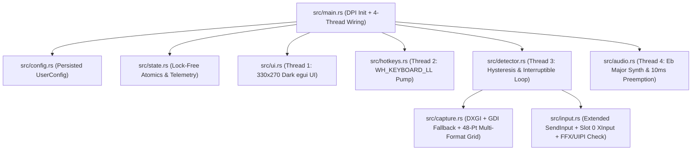

# FFX Lightning Dodger — Implementation Plan

## Goal & Authoritative Specification

Build **FFX Lightning Dodger** (`ffx-lightning-dodger.exe`), a standalone `< 8 MB` Rust Windows desktop utility that detects *Final Fantasy X HD Remaster* Thunder Plains full-screen lightning flashes across a movement-safe `8x6` spatial grid and injects hardware scan-code dodges across `1x`, `2x`, and `4x` game speeds while playing procedural $\text{E}\flat$ Major chimes every $N$ dodges.

> [!IMPORTANT]
> **Handoff Context for Fresh Execution Conversation:**
> - **Repository & Directory:** This project lives under `ffx-lightning-dodger/` inside `xredcomet/bwang418-web-sandbox` (attach `xredcomet/bwang418-web-sandbox` to the Antigravity project if not already pre-cloned in `/home/antigravity/xredcomet/bwang418-web-sandbox`).
> - **Authoritative Spec:** Read [ffx_lightning_dodger_design.md](./ffx_lightning_dodger_design.md) (`ffx-lightning-dodger/docs/ffx_lightning_dodger_design.md`) first. All requirements-and-design inconsistencies have already been resolved in that document.
> - **Cloud VM Build Notes:**
>   1. The VM preinstalls `rustc`, `cargo`, `clang`, `lld-link`, `llvm-rc`, and `llvm-windres-14` on `x86_64-unknown-linux-gnu` (`RUSTUP_HOME=/usr/local/rustup` is read-only; if adding Rust targets locally, copy/point `RUSTUP_HOME` to `$HOME/.rustup`).
>   2. Keep **all core logic pure-Rust and OS-decoupled** behind `#[cfg(windows)]` backends so `cargo test` inside `ffx-lightning-dodger/` runs 100% of unit tests natively on Linux in seconds, and add `.github/workflows/ffx-lightning-dodger.yml` at the repository root (`working-directory: ffx-lightning-dodger`, `windows-latest` MSVC) so every change under `ffx-lightning-dodger/**` builds and uploads a native `< 8 MB` `ffx-lightning-dodger.exe`.

---

## Architecture & Module Map

| File (under `ffx-lightning-dodger/`) | Responsibility | Host-Testable (`cargo test` on Linux)? |
| :--- | :--- | :--- |
| `Cargo.toml` | Minimal crate features (`eframe` `glow`, `cpal`, `windows`, `serde`), size-optimized release profile | Yes (`target.'cfg(windows)'.dependencies` for `windows` / `embed-resource`) |
| `app.manifest` & `build.rs` | `asInvoker` execution level + `PerMonitorV2` DPI awareness manifest resource | Yes (`build.rs` no-ops cleanly when target OS $\neq$ `windows`) |
| `src/config.rs` | `UserConfig`, `KeyBinding` enum/VK mapping, validation/clamping, `%APPDATA%` JSON load/save | **100% unit-tested** |
| `src/state.rs` | `AppState` lock-free atomics, transient `require_ffx_focus = true`, rebind capture coordination | **100% unit-tested** |
| `src/audio.rs` | `AudioEvent` enum, 44.1 kHz $\text{E}\flat$ Major polyphonic synth, 10 ms raised-cosine preemption, `cpal` WASAPI sink | **100% of PCM synth, voice normalization, & preemption unit-tested** |
| `src/capture.rs` | Pure-Rust 15% inset + monitor clipping + `BGRA8`/`RGBA8`/`R10G10B10A2`/`RGBA16F` 48-point luma/saturation decoder; `#[cfg(windows)]` DXGI + GDI backends | **Grid crop & all 4 pixel-format decoders unit-tested** |
| `src/detector.rs` | Coupled `T_high`/`T_rearm`/`T_base_max` math, EMA baseline, hysteresis state machine, interruptible `1–2 ms` slice waits, worker loop | **100% of state machine, 4x timing, & interruptions unit-tested** |
| `src/input.rs` | Extended scan-code mapper, `SendInput` + RAII key-up guard, Slot 0 rising-edge `XInputGetState` (`500 ms` disconnect backoff), `FFX.exe` & UIPI elevation check | **Scan-code flags & rising-edge/backoff state machine unit-tested** |
| `src/hotkeys.rs` | Pure-Rust `evaluate_key_event` rule engine (context-aware swallowing, rebind capture, physical `'C'` clash); `#[cfg(windows)]` `WH_KEYBOARD_LL` + `GetMessageW` thread | **100% of hotkey & clash rules unit-tested** |
| `src/ui.rs` | `330x270` (`330x450` expanded) dark `egui` interface, live brightness meter, UIPI/clash banners, duplicate-keybind guard | Compiles cross-platform |
| `src/main.rs` | `#![cfg_attr(not(debug_assertions), windows_subsystem = "windows")]`, `PerMonitorV2` startup call, 4-thread lifecycle & graceful shutdown | Compiles cross-platform |

---

## Phased Implementation Steps

### Phase 1: Project Scaffolding & Cross-Platform Build Setup
1. Initialize the Cargo package inside `ffx-lightning-dodger/` (edition `2021` or `2024`).
2. Configure `ffx-lightning-dodger/Cargo.toml`:
   - Cross-platform dependencies:
     - `eframe` (`default-features = false`, features = `["glow", "default_fonts"]`)
     - `cpal` (stream `f32` PCM to default WASAPI output without audio file decoder bloat)
     - `serde` (`derive`), `serde_json`, `dirs`
   - `[target.'cfg(windows)'.dependencies]`:
     - `windows` with exact features: `Win32_Foundation`, `Win32_Graphics_Direct3D`, `Win32_Graphics_Direct3D11`, `Win32_Graphics_Dxgi`, `Win32_Graphics_Dxgi_Common`, `Win32_Graphics_Gdi`, `Win32_Media`, `Win32_Security`, `Win32_System_LibraryLoader`, `Win32_System_Threading`, `Win32_UI_HiDpi`, `Win32_UI_Input_KeyboardAndMouse`, `Win32_UI_Input_XboxController`, `Win32_UI_WindowsAndMessaging`.
   - `[target.'cfg(windows)'.build-dependencies]`: `embed-resource` (or `winresource`).
   - `[profile.release]`: `opt-level = "s"`, `lto = "thin"`, `codegen-units = 1`, `panic = "abort"`, `strip = true`.
3. Create `ffx-lightning-dodger/app.manifest` + `app.rc` + `build.rs`:
   - Embed `requestedExecutionLevel level="asInvoker"` and `<dpiAwareness>PerMonitorV2, PerMonitor</dpiAwareness>` / `<dpiAware>true/pm</dpiAware>`.
   - Guard `build.rs` on `std::env::var("CARGO_CFG_TARGET_OS") == Ok("windows".into())`, checking tool availability gracefully so minimal cross-builds without `rc.exe`/`windres` emit a warning rather than failing compilation (since `main.rs` also calls `SetProcessDpiAwarenessContext` at runtime).
4. Add `.github/workflows/ffx-lightning-dodger.yml` (at repository root, scoped to `ffx-lightning-dodger/**` + `workflow_dispatch`):
   - Runs `cargo test` + `cargo clippy --all-targets -- -D warnings` with `working-directory: ffx-lightning-dodger` and builds `cargo build --release --target x86_64-pc-windows-msvc` on `windows-latest`, asserting `ffx-lightning-dodger.exe` size `< 8,388,608` bytes (`8 MB`) and uploading the `.exe` workflow artifact.

---

### Phase 2: Configuration & Shared Lock-Free State (`src/config.rs`, `src/state.rs`)
1. Implement `KeyBinding` (`u16` Win32 Virtual-Key code + human-readable label formatter covering `F1`–`F24`, `A`–`Z`, `0`–`9`, `Space`, `Enter`, `Tab`, modifiers, navigation/arrow keys, and numpad keys).
2. Implement `UserConfig` in `src/config.rs`:
   - Fields & defaults:
     - `chime_every_n: u32 = 205` (clamped $\ge 1$)
     - `volume: f32 = 0.65` (clamped `[0.0, 1.0]`)
     - `start_pause_vk: u16 = 0x77` (`VK_F8`)
     - `reset_vk: u16 = 0x78` (`VK_F9`)
     - `dodge_vk: u16 = 0x43` (`'C'`)
     - `reaction_delay_ms: u32 = 25` (clamped `[0, 200]`)
     - `key_hold_ms: u32 = 50` (clamped `[35, 200]`)
     - `refractory_ms: u32 = 150` (clamped `[80, 1000]`)
     - `flash_threshold: f32 = 0.80` (clamped **`[0.60, 0.95]`**)
     - `clash_reset: bool = true`
     - `always_on_top: bool = false`
   - Validation helper `has_duplicate_keys()` / `try_rebind(slot, new_vk)` rejecting collisions across `start_pause_vk`, `reset_vk`, and `dodge_vk` (falling back to defaults if a hand-edited `config.json` contains duplicates).
   - Load/save at `%APPDATA%\ffx-lightning-dodger\config.json` (`dirs::config_dir()`), silently returning `UserConfig::default()` if missing or corrupt.
3. Implement `AppState` in `src/state.rs`:
   - Lock-free atomics for all hot-path values (`armed`, `require_ffx_focus` **always initialized to `true` and excluded from `UserConfig`**, `dodge_count`, `chime_every_n`, `volume_bits`, key VKs, timing ms, `flash_threshold_bits`, `clash_reset`, `rebind_slot`, `captured_rebind_vk`, `ffx_focused`, `self_focused`, `uipi_blocked`, `live_mean_y_bits`, `status_phase`, `clash_banner_until_ms`, `shutdown`).
   - Shared `RwLock<Option<egui::Context>>` (or repaint callback) so background threads wake the UI immediately on dodge, clash, or hotkey toggle without polling lag.

---

### Phase 3: Procedural $\text{E}\flat$ Major Audio Synth & Preemption (`src/audio.rs`)
1. Define `pub enum AudioEvent { Start, Stop, ClashReset, MilestoneFanfare }` sent over `std::sync::mpsc::sync_channel<AudioEvent>(16)`.
2. Implement pure-Rust `44,100 Hz` mono `f32` cue synthesis:
   - **Lead / Harmony oscillator:** `0.55 * sin(phase) + 0.30 * triangle(phase) + 0.15 * sin(2.0 * phase)` with `5.5 Hz` vibrato ($\pm 0.4\%$ frequency modulation) ramping in after `150 ms` on sustained notes.
   - **Bass oscillator:** `0.70 * triangle(phase) + 0.30 * sin(phase)`.
   - **Per-note envelope:** `6 ms` linear attack, decay to `0.80` sustain floor, `10 ms` raised-cosine release reaching exact `0.0` at note gate end, followed by exact `0.0` gap/rest samples.
   - **Cues:**
     - `Start`: `Bb4 (466.16 Hz, 75 ms)` $\rightarrow$ `15 ms` rest $\rightarrow$ `Eb5 (622.25 Hz, 120 ms)`.
     - `Stop`: `Eb5 (622.25 Hz, 75 ms)` $\rightarrow$ `15 ms` rest $\rightarrow$ `Bb4 (466.16 Hz, 130 ms)`.
     - `ClashReset`: `Eb4 (311.13 Hz, 55 ms)` $\rightarrow$ `20 ms` rest $\rightarrow$ `D4 (293.66 Hz, 75 ms)`.
     - `MilestoneFanfare`: Exact 9-step `138 BPM` sequencer table from §4.4 (~`2.83 s` total) mixed at **`0.50 * Lead + 0.15 * Harmony_1 + 0.15 * Harmony_2 + 0.20 * Bass`**.
   - Pre-render the 4 canonical `Vec<f32>` unscaled unit buffers once at Audio Thread startup (~`550 KB` total RAM, zero per-event heap allocation!).
3. Implement `PreemptingPlayer` state machine (unit-testable independent of `cpal`):
   - Streams samples from the active buffer scaled by `volume` (`[0.0, 1.0]`) and clamped to `[-1.0, 1.0]`.
   - When `rx.try_recv()` yields a new `AudioEvent` mid-playback (draining to the latest queued event if multiple arrived simultaneously), transitions into a `441`-sample (`10 ms` at `44.1 kHz`, scaled proportionally if device sample rate differs, e.g. `480` samples at `48 kHz`) raised-cosine fade-out of the current cue, then immediately starts sample `0` of the new cue.
4. Wire `cpal` output stream (resampling linearly if the default Windows WASAPI shared-mode mix format is `48,000 Hz` vs `44,100 Hz`, and degrading gracefully without crashing if no audio output device is plugged in).

---

### Phase 4: Screen Capture & Multi-Format 48-Point Grid Sampler (`src/capture.rs`)
1. Implement pure-Rust geometry & pixel-format sampler:
   - `compute_safe_grid_coords(client_rect, monitor_rect) -> Option<[(u32, u32); 48]>`:
     - Insets `client_rect` by `15%` on all 4 sides, intersects with `monitor_rect` in monitor-local physical coordinates, returns `None` if width or height `< 16 px`, and computes the `8 x 6` evenly spaced interior sample points.
   - `enum SurfaceFormat { Bgra8Unorm, Rgba8Unorm, R10G10B10A2Unorm, Rgba16Float }`:
     - Decodes normalized gamma-encoded sRGB `(r, g, b)` in `[0.0, 1.0]` at each of the 48 points (for `Rgba16Float` Windows HDR scRGB, normalizes linear light against SDR white `1.0`, clamps `[0.0, 1.0]`, and applies linear-to-sRGB transfer curve so `T_high = 0.80` behaves identically on HDR and SDR monitors).
   - `evaluate_grid_samples(samples: &[(f32, f32, f32); 48], t_high: f32) -> GridMetrics`:
     - Computes $Y_i = 0.2126 R_i + 0.7152 G_i + 0.0722 B_i$, saturation $S_i = \max(R,G,B) - \min(R,G,B)$, `mean_y`, and `bright_fraction` (count of points with $Y_i \ge T_{\text{high}}$ and $S_i \le 0.25$ divided by `48.0`).
2. Implement `#[cfg(windows)]` `ScreenCapturer`:
   - Primary: `IDXGIOutputDuplication` bound to the `IDXGIOutput` matching `MonitorFromWindow(ffx_hwnd, MONITOR_DEFAULTTONEAREST)` (re-binding automatically if the user moves windowed FFX to another monitor). Calls `AcquireNextFrame(8, ...)` and maps a CPU-readable staging `ID3D11Texture2D`:
     - `DXGI_ERROR_WAIT_TIMEOUT`: returns `CapturePoll::Unchanged` (screen static; `< 0.05 ms` CPU).
     - `DXGI_ERROR_ACCESS_LOST` or unsupported `DXGI_FORMAT`: drops duplication handle and falls back to GDI `BitBlt(SRCCOPY)` + `GetDIBits` (`BGRA8`) on the target rect while scheduling DXGI re-initialization.

---

### Phase 5: Flash Detector & Interruptible Dodge State Machine (`src/detector.rs`)
1. Implement pure-Rust `FlashDetector`:
   - States: `Paused`, `StandbyUnfocused`, `ArmedWatching`, `ReactionDelay { t_trigger }`, `PressingKey { t_trigger, t_press_start }`, `CooldownWaitDark { t_trigger }`.
   - Coupled threshold helper:
     - `t_high = raw_threshold.clamp(0.60, 0.95)`
     - `t_rearm = (t_high - 0.20).min(0.45)`
     - `t_base_max = (t_high - 0.15).min(0.55)`
   - EMA `baseline_y` initialized from the first dark frame and updated via `baseline_y += 0.05 * (mean_y - baseline_y)` only while `mean_y < t_base_max`.
   - Rising-edge trigger in `ArmedWatching`: `bright_fraction >= 0.75 && (mean_y - baseline_y) >= 0.35`.
   - Interruptible transitions on every `1–2 ms` tick during `ReactionDelay` and `PressingKey`:
     - If `!armed`: if in `PressingKey`, emit `Action::KeyUp` immediately; transition to `Paused`.
     - Else if `require_ffx_focus && !ffx_focused`: if in `PressingKey`, emit `Action::KeyUp` immediately; transition to `StandbyUnfocused` (aborting any pending `ReactionDelay` press so `'c'` never leaks into an Alt-Tabbed window).
     - When `ReactionDelay` reaches `reaction_delay_ms` (`25 ms`): emit `Action::KeyDown` and enter `PressingKey`.
     - When `PressingKey` reaches `key_hold_ms` (`50 ms`): emit `Action::KeyUp`, increment `dodge_count`, enqueue `AudioEvent::MilestoneFanfare` if `new_count % chime_every_n == 0`, and enter `CooldownWaitDark { t_trigger }`.
     - In `CooldownWaitDark`: transition to `ArmedWatching` only when `(now - t_trigger) >= refractory_ms` (`150 ms` default) **and** `mean_y <= t_rearm`.
2. Implement Thread 3 worker loop:
   - Manages `timeBeginPeriod(1)` while `armed` (releasing via `timeEndPeriod(1)` when `Paused` or exiting via RAII Drop guard).
   - Polls Foreground/UIPI status, Slot 0 XInput clash monitor, and `ScreenCapturer` (`8 ms` DXGI cadence in `ArmedWatching` / `CooldownWaitDark`, switching to `1 ms` sleep slices while inside `ReactionDelay` / `PressingKey`, and `50 ms` idle sleep when `Paused` or `StandbyUnfocused`).

---

### Phase 6: Win32 Input, XInput Slot 0 Monitor, & `WH_KEYBOARD_LL` Thread (`src/input.rs`, `src/hotkeys.rs`)
1. Implement `src/input.rs`:
   - `resolve_scancode(vk: u16)` (`#[cfg(windows)]` `MapVirtualKeyW(vk, MAPVK_VK_TO_VSC_EX)`): extracts `wScan = (raw & 0xFF) as u16` and `is_extended = matches!(raw >> 8, 0xE0 | 0xE1)`, setting `KEYEVENTF_SCANCODE` (`| KEYEVENTF_EXTENDEDKEY` when `is_extended`).
   - `HeldKeyGuard`: tracks whether `SendInput` currently holds a key down and guarantees a matching `KEYEVENTF_KEYUP` on Pause, Focus Loss, or thread `Drop`.
   - `Slot0ClashMonitor`: pure-Rust state machine wrapping `XInputGetState(0, ...)`:
     - Only polled when `armed && (ffx_focused || !require_ffx_focus) && clash_reset_enabled`.
     - Fires clash reset strictly on rising edge (`!prev_a_pressed && curr_a_pressed`).
     - If Slot 0 returns disconnected, skips Win32 `XInputGetState(0, ...)` calls for `500 ms` so unplugged-controller systems suffer zero device-probe latency.
   - `inspect_foreground_window()`:
     - Checks if foreground `HWND` belongs to our own PID (`self_focused`).
     - Queries process image via `OpenProcess(PROCESS_QUERY_LIMITED_INFORMATION)` + `QueryFullProcessImageNameW`, matching ASCII case-insensitive basename `ffx.exe` (falling back to exact `GetWindowTextW == "FINAL FANTASY X"` if `OpenProcess` fails).
     - When `FFX.exe` is matched, checks `OpenProcessToken(TOKEN_QUERY)` + `GetTokenInformation(TokenElevation)` against our own elevation once per PID to populate `state.uipi_blocked`.
2. Implement `src/hotkeys.rs`:
   - Pure-Rust `evaluate_key_event(...) -> KeyDecision` (covering key-repeat debouncing via a 256-bit `held_vks` table, rebind capture mode with `VK_ESCAPE` cancel + duplicate-key rejection, context-aware `F8`/`F9` dispatch + `Swallow` when `ffx_focused || self_focused || armed || !require_ffx_focus`, and `!injected` physical `dodge_vk` rising-edge clash reset when `armed && (ffx_focused || !require_ffx_focus) && clash_reset_enabled`).
   - `#[cfg(windows)]` Thread 2: installs `SetWindowsHookExW(WH_KEYBOARD_LL, ...)`, pumps `GetMessageW`, and exits cleanly via `PostThreadMessageW(hook_tid, WM_QUIT, ...)` + `UnhookWindowsHookEx` on app shutdown.

---

### Phase 7: Compact Dark `egui` Interface & Main Entrypoint (`src/ui.rs`, `src/main.rs`)
1. Implement `DodgerApp` (`eframe::App`) in `src/ui.rs`:
   - Window configured at `330.0 x 270.0` logical pixels (`ViewportCommand::InnerSize` resizing smoothly to `330.0 x 450.0` when *Hotkeys & Advanced Settings* is expanded; non-resizable horizontal width).
   - Custom dark visuals (`#14171F` background, `#1E222D` card surface, `#3B82F6` armed accent, `#10B981` 250 ms dodge flash highlight, `#F59E0B` amber standby/clash/UIPI warning).
   - Top bar: title `⚡ FFX Lightning Dodger` and `[📌 Top: ON/OFF]` toggle (`ViewportCommand::WindowLevel`).
   - Conditional warning strip: UIPI Admin elevation warning (`uipi_blocked`) or 3-second amber clash reset notice.
   - Status row (`● PAUSED`, `● ARMED — Watching FFX`, or `● STANDBY — FFX Unfocused`), large monospace `dodge_count` card + `Reset (F9)` button, full-width `START / PAUSE AUTO-DODGE (F8)` button, `Chime Every` integer input (`>= 1`) with `[-]`/`[+]` steppers + `[🔊]` preview button (`AudioEvent::MilestoneFanfare`), and `Volume` slider (`0%–100%`).
   - Collapsible `Hotkeys & Advanced Settings`:
     - Interactive rebind buttons (`Start/Pause Key`, `Reset Key`, `FFX Dodge Key`) showing `"Press key... (Esc)"` while capturing and brief inline feedback if a duplicate key is pressed.
     - Sliders for `Reaction Delay` (`0–150 ms`, default `25 ms`), `Key Hold Time` (`35–150 ms`, default `50 ms`), `Refractory Wait` (`80–600 ms`, default `150 ms`), and `Flash Threshold` (`60%–95%`, default `80%`), plus live `mean_Y` progress bar (`Dark` / `Flash`) and tooltips (noting Borderless recommendation and DirectInput gamepad note).
     - Checkboxes: `[x] Only active when FINAL FANTASY X is focused` (tooltip noting it resets `On` each launch) and `[x] Reset counter on manual 'A' / Confirm press`.
   - Persist dirty `UserConfig` changes to `%APPDATA%\ffx-lightning-dodger\config.json` (debounced ~`250 ms` so dragging sliders doesn't thrash disk I/O).
2. Implement `src/main.rs`:
   - `#![cfg_attr(not(debug_assertions), windows_subsystem = "windows")]`
   - Call `SetProcessDpiAwarenessContext(DPI_AWARENESS_CONTEXT_PER_MONITOR_AWARE_V2)` at startup on Windows.
   - Load `UserConfig`, initialize `Arc<AppState>` and `mpsc::sync_channel::<AudioEvent>(16)`, spawn Threads 2 (`hotkeys`), 3 (`detector`), and 4 (`audio`), launch `eframe::run_native`, and join/clean up worker threads in `App::on_exit`.

---

## Verification & Acceptance Plan

1. **Automated Unit & Integration Tests (`cargo test`):**
   - **`detector` tests:**
     - Local bright patches (`20%` of grid at `0.95`) during simulated camera movement $\rightarrow$ `0` triggers.
     - Full-screen flash (`0.92` across `>= 75%` of grid) lingering for `200 ms` (`> 150 ms` refractory) $\rightarrow$ **exact `1` trigger** (held in `CooldownWaitDark` until `mean_Y <= T_rearm`).
     - Simulated **4x Turbo North Crater double-strike** (flash 1 at `t = 0 ms`, dark return at `t = 60 ms`, flash 2 at `t = 200 ms`) $\rightarrow$ **exact `2` triggers**.
     - Lowering `Flash Threshold` to `60%` derives `T_rearm = 0.40` and clears `CooldownWaitDark` cleanly at `mean_Y = 0.38`.
     - Mid-`ReactionDelay` focus loss aborts press (`0` `KeyDown` emitted, `dodge_count` unchanged); mid-`PressingKey` Pause or focus loss emits immediate `KeyUp`.
   - **`capture` tests:**
     - Verify `15%` safe inner crop + multi-monitor rectangle clipping (including partially off-screen and `< 16x16` minimized windows) and exact luma/saturation decoding across synthetic `BGRA8`, `RGBA8`, `R10G10B10A2`, and `RGBA16F` buffers.
   - **`hotkeys` & `input` tests:**
     - Verify `F8`/`F9` swallow (`Swallow`) when FFX focused, utility focused, Armed on another window, or Focus Guard off—and `PassThrough` when Paused on Notepad/IDE with Focus Guard on.
     - Verify synthetic `LLMHF_INJECTED` `'C'` presses never trigger Clash Reset, physical `'C'` and Slot 0 rising-edge `'A'` reset `dodge_count` only when Armed & actively watching, disconnected Slot 0 backs off for `500 ms`, and duplicate keybinds are rejected.
   - **`audio` tests:**
     - Assert `Start`, `Stop`, `ClashReset`, and `MilestoneFanfare` buffers contain finite samples strictly in `[-1.0, 1.0]`, start and end at exact `0.0`, match expected sample counts, and execute a click-free `441`-sample (`10 ms`) fade-out without exceeding `[-1.0, 1.0]` when preempted mid-fanfare.
   - **`config` tests:**
     - Round-trip JSON serialization, out-of-range slider clamping (`flash_threshold` $\rightarrow$ `[0.60, 0.95]`, `chime_every_n = 0` $\rightarrow$ `1`), duplicate-key fallback, and verification that `require_ffx_focus` always starts `true`.
2. **Static Analysis & Windows Release Build Check:**
   - Run `cargo clippy --all-targets -- -D warnings` and `cargo fmt --check`.
   - Build Windows x64 release binary (locally via Windows target if cross-toolchain/network permits and/or via `.github/workflows/ffx-lightning-dodger.yml` on GitHub Actions) and verify stripped `.exe` size `< 8 MB`.
